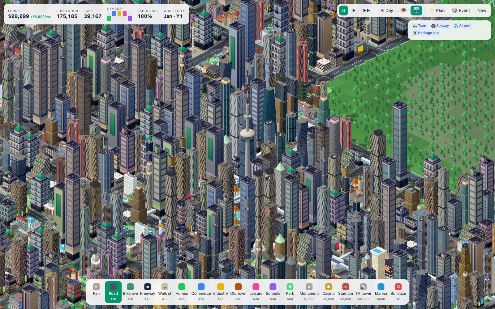
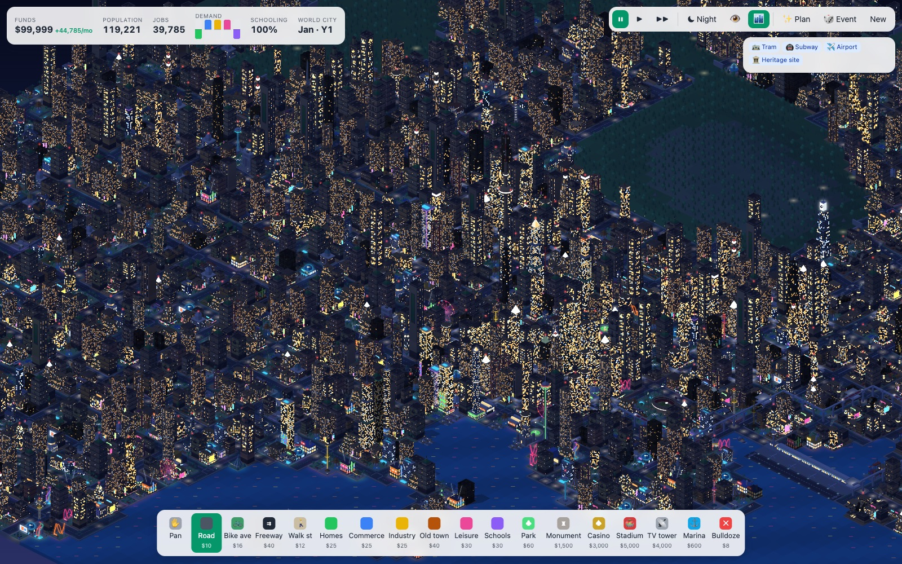

# citybuilder

An isometric city builder in a single HTML file, set somewhere between Hong Kong and Monaco: hillside towers, harbour, neon by night.

**Play:** https://wozacosta.github.io/citybuilder/

## What's in it

- **A city that grows at its own pace:** a 96×96 map of hills and harbour. A handful of buildings rise each month, so watching it fill in is calm.
- **Zones:** residential, commercial and industrial, plus historic centre, tourism and education. Buildings grow through five levels, and run-down ones go grimy before they decline.
- **Business districts:** skyscrapers cluster in up to three districts that form as the city grows. Residential towers only rise when homes are badly short.
- **Hills and tunnels:** roads and hillsides slope, buildings on a slope stand on retaining walls, and roads tunnel through mountains.
- **Elevated walkways:** glass footbridges and covered decks link the towers of busy districts.
- **Roads:** normal streets, freeways, streets with bike lanes, and pedestrian streets.
- **Transport arrives on its own:** trams, subway stations (some open inside tower podiums), an airport, and an elevated monorail out to it once the city reaches 4,000 people.
- **Landmarks:** 21 monuments, 3 stadium types and 4 TV and communication towers.
- **Events:** a company moving its HQ to town, a film shot there, storms. Each one changes the numbers.
- **Plan:** one button lays out a whole city with zones, roads, parks and landmarks.
- **Day and night**, with lit windows and neon signs.

Open `index.html` in a browser; there's nothing to install or build. The game saves to `localStorage`.

## Graphics

Buildings are 3D models baked into sprites, about 265 of them. Some come from [Kenney's](https://kenney.nl) City Kits (CC0). The rest are built in three.js: stadiums, TV towers, monuments, run-down mansion blocks, and a procedural generator (`buildings.js`) for villas, Belle Époque blocks, shophouses, housing estates and glass towers. The baked atlas is embedded in `index.html`. Press **G** or 🏙 to switch to the original hand-drawn sprites.

To re-bake the sprites, see `tools/bake/`:

1. Unzip Kenney's City Kit Commercial, Industrial, Suburban and Roads into `tools/dl/commercial`, `industrial`, `suburban` and `roads`.
2. In `tools/bake`, run `npm install`.
3. Run `node bake.js`. It needs Google Chrome installed and writes `baked.json` and preview PNGs.
4. Run `python3 embed.py` to put the new atlas into `index.html`.

The tile recipes are in `recipes.js` and the custom models are in `models.js`.

Created in [T3 Code](https://t3.codes).
